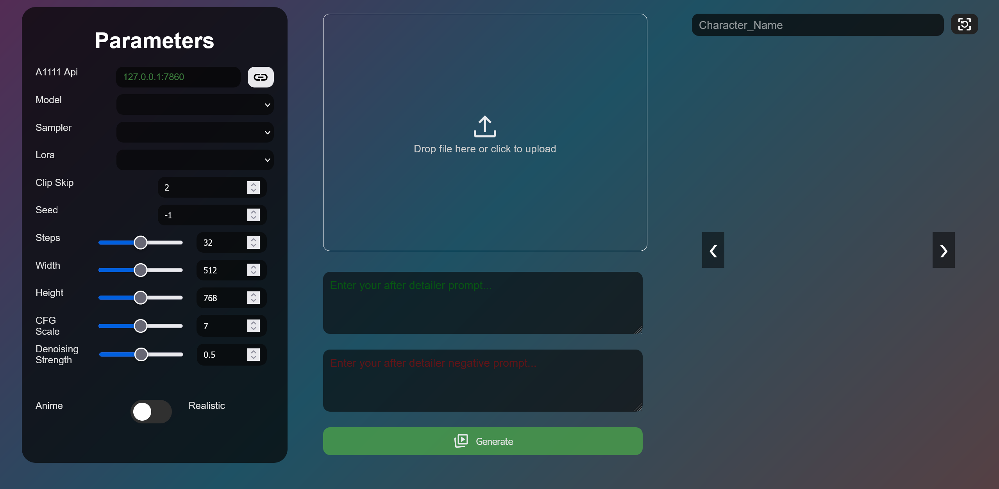

# Changelog

All notable changes to AutoExpress are listed here, newest first.

## Unreleased

### New
- **Poses**: change the pose along with each expression, for visual novel and chatbot sprites. Each of the 28 expressions has a small gesture that starts from the character's current pose (arms crossed for anger, a hand on the chin for curiosity), keeping the outfit, framing and background. Made with Qwen-Image-Edit on ComfyUI: in one edit with the instruction edit mode, or as a pose edit before face inpainting. A `pose` input on the Edit Instructions node, **Change pose too** in the standalone app and `"pose": true` on `POST /generate`.

## 2.1.1 (2026-10-24)

- **macOS releases**: `autoexpress-<version>-macOS_Release.zip` for Apple silicon (macOS 14+) and `autoexpress-<version>-macOS-Intel_Release.zip` for Intel Macs, started with `./run.sh`. The Intel build has no Remove background, since onnxruntime isn't built for Intel Macs.
- Dependencies live in `pyproject.toml` and `requirements.txt` is gone: `dependencies` for the WebUI extension and nodes, a `standalone` extra for the app and a `dev` group for tests. `uv.lock` pins every package with hashes and platform markers.
  - The release zips, the Docker image and `install` (when [uv](https://docs.astral.sh/uv/) is installed) install exactly the versions in `uv.lock`, picking the right wheels for each OS and CPU. Without uv, `install` uses `pip install -e ".[standalone]"`.
  - Installing AutoExpress into ComfyUI from git no longer pulls the standalone app's dependencies (Flask, rembg, ...) into ComfyUI.
- Release zips bundle their own Python (3.13, in `runtime/`), each built on its own platform from prebuilt wheels only, so a missing wheel fails the build instead of shipping a zip that doesn't start. Before, the zips carried a virtual environment that pointed at the build machine's Python.
- `run` and `run_debug` use the bundled Python when it's there, and `.venv` otherwise. On macOS they clear the download quarantine on the bundled Python.
- Each release zip is smoke tested (the app starts, serves the web interface, and Remove background is available where it should be) before it's published.
- Zip names keep the version as tagged, e.g. `autoexpress-v2.1.1-Linux_Release.zip`.
- The dependency audit checks the versions pinned in `uv.lock`, and Dependabot updates `uv.lock`.

## 2.1.0 (2026-10-24)

### New
- **Instruction edit mode** on ComfyUI: Qwen-Image-Edit changes the expression from one sentence instead of inpainting the face. Tuned illustration and photo wordings for all 28 expressions, an Edit Instructions node, readiness checks and an example workflow that needs only core nodes.
  - Photos use Qwen-Image-Edit-2511 at 40 steps and CFG 4, and only the edited face is pasted back onto the original through a feathered mask, so the rest of the photo is untouched.
- **Expression intensity** slider (0 to 1) with a default per model family: inpainting with expression LoRAs for anime families, instruction edit with photo wording for realistic and natural-language models.
- The standalone app works with a WebUI hosted anywhere (LAN, RunPod and other hosts, https, reverse-proxy sub-paths, logins). Nothing assumes it runs on this machine.
  - **Detect automatically** (the new default) reads the WebUI type from its API: A1111, Forge, SD.Next, ComfyUI, SwarmUI or InvokeAI.
  - After connecting, a setup check lists what the WebUI has and what's missing (ADetailer and its face model, Impact Pack and Subpack, face detection models, checkpoints, samplers, LoRAs). Each missing piece comes with steps for that WebUI, commands to copy, links, and a **Re-check** button. Also at `GET /backend/capabilities`.
  - Connection errors say what to try: `--listen`, the host's proxy URL, or the login.
  - A RunPod proxy URL for a port the pod doesn't expose says to add the port under Expose HTTP Ports.
  - Expression LoRAs you renamed on the WebUI are recognised by the hashes in their metadata (A1111 family, InvokeAI with sha256 hashing).
  - Expression LoRAs are written to the LoRA folder only when it's on this machine. InvokeAI installs missing ones itself through its Model Manager. For other WebUIs, the run lists each missing LoRA with its download link (`notes` on the job).
- **Remove background** in the standalone app saves every expression with a transparent background, only the character is kept. Uses rembg (`isnet-anime` for drawn characters, `u2net_human_seg` for photos), installed from `requirements.txt`. Also `"remove_background": true` on `POST /generate`, and `GET /background-removal`.

### Changed
- The expression LoRA base (SD 1.5, SD 2, SDXL, Flux) is read from the model itself instead of guessed from the checkpoint name, so SD 1.5 checkpoints with unusual names no longer get SDXL LoRAs. The name still tells Pony and Illustrious apart from plain SDXL.
- LoRA entries can set a weight per expression (0 drops the LoRA and its trigger). The Illustrious expressions LoRA is skipped for anger, and the Illustrious family recommends NoobAI-XL, WAI and other finetunes over base Illustrious-XL 0.1.
- `install.sh` / `install.bat` build the web interface too (Node.js 20.9+, pnpm or corepack), check for Python 3.10+, reuse `.venv` unless `--clean` is given and accept `--skip-frontend`. `install.sh` no longer runs `apt update/upgrade`, so it works on macOS.
- `run` / `run_debug` check that the app is installed and start from their own folder. `run_debug` listens on 127.0.0.1 by default, since the Werkzeug debugger can run code.
- The Docker image runs as an unprivileged user (uid 1000). A mounted results folder needs to be writable by it. `--build-arg PRELOAD_REMBG_MODELS="..."` bakes background removal models into the image.
- The frontend, release zips and Docker image build on Node 26 (the Docker image installs pnpm with npm, since corepack is gone).
- Release notes come from this changelog.
- Each release publishes the Docker image to `ghcr.io/deepratna-awale/autoexpress`. The Docker Hub image is no longer updated.
- matplotlib is no longer a dependency.
- README and docs restructured, with a page per integration under [docs/](docs/).

### Security
- Option values and labels are escaped in the classic interface, the LoRA tag parser runs in linear time, and release jobs get minimal permissions.
- Dependabot and a weekly dependency audit (pip-audit and pnpm audit); sd-parsers 0.6 and higher requirement floors.

## 2.0.0 (2026-10-23)
- New web interface built with Next.js and shadcn/ui (in [frontend/](frontend/)). Flask serves it at http://127.0.0.1:5000 once it is built; the original interface stays at `/classic`.
  - Resizable panels, mobile layout, light/dark mode and a theme editor with presets (saved in the browser).
  - LoRA picker with a strength per LoRA, live gallery that fills in while expressions generate, raw metadata viewer.
  - Shows the Prompt Style and WebUI backend selectors when the backend supports them.
- Release zips and the Docker image include the built interface.
- Expression prompts now come in one set per model family: Danbooru, e621, Pony, Illustrious/NoobAI, SDXL/SD1.5 (CLIP) and natural language (Flux, SD3, ...).
- The Anime/Realistic switch is replaced by a **Prompt Style** dropdown. **Auto** picks the family from the checkpoint name.
- Family quality tags (e.g. Pony `score_` tags) and negatives are added only when missing from your prompt.
- Expression LoRAs matched to the checkpoint (Pony, Illustrious/NoobAI, SDXL, SD1.5, Flux) are added to the prompt, and downloaded from Civitai into the WebUI's LoRA folder when they're missing.
- The standalone app can now drive other WebUIs, picked from a new **WebUI** dropdown: AUTOMATIC1111, Forge / reForge, SD.Next, ComfyUI (FaceDetailer), SwarmUI (`<segment:face>`) and InvokeAI (face mask inpainting).
  - New `GET /backends` route, and `POST /receive_data` takes an optional `backend` id.
  - A1111 style requests drop built-in scripts the server does not have, so Forge and SD.Next no longer reject them.
  - `/generate` reports why a WebUI is not ready (API unreachable, ADetailer or Impact Pack missing, no models).
- Standalone app hardened for production:
  - Timeouts, retries with backoff, basic/bearer auth (and SwarmUI / InvokeAI logins) for every WebUI, with typed error codes shown in the UI.
  - Generation runs as a queued background job: `/jobs`, `/jobs/<id>`, `/jobs/<id>/cancel`, live progress on the Generate button, no overlapping runs.
  - `/health` and `/backend/status` (reachability, readiness, version).
  - `/generate` checks the WebUI before queueing and answers failures with a matching HTTP status (503 unreachable, 504 timeout, 401 auth, 409 not ready, 502 rejected).
  - Step progress on A1111, Forge and SD.Next during the ADetailer pass.
  - Reuses the Civitai key the selected WebUI already has (Civitai Browser+ / Civitai Helper, ComfyUI LoRA Manager) when none is entered.
  - ComfyUI: softer FaceDetailer blending (no paste seam over the hair), and saved PNGs carry A1111 style parameters.
  - Input validation on `/generate` and `/upload`; output folder names can no longer escape the output directory, and `/images/..` is blocked.
  - Configuration through `AUTOEXPRESS_*` environment variables, JSON logs and request ids, `python -m autoexpress` serves with waitress, Docker health check.
- AutoExpress now runs inside other WebUIs:
  - **AUTOMATIC1111 / Forge / reForge / SD.Next extension**: an AutoExpress tab that runs ADetailer in-process, so `--api` is not needed. It reads prompt, sampler and seed from the uploaded image and can build a sprite sheet.
  - **ComfyUI nodes**: Expression Prompts, Expression Prompt, Expression LoRAs, Save Expressions and Sprite Sheet, used together with Impact Pack's FaceDetailer.
  - **InvokeAI node**: Expression Prompts.
- Expression prompt sets, expression LoRAs, payloads and the generation loop moved into a shared `autoexpress_core` package that every integration uses.
- Fixed the Interrupt button in the standalone app, which raised an error instead of stopping generation.
- The base prompt and expression prompt are now joined with a comma.
- The seed setting now reaches A1111 1.9+ (it was overridden by the built-in Seed script).

## 2024-11-13
- Docker image available here: [AutoExpress on DockerHub](https://hub.docker.com/r/deepratna/autoexpress)
- Added Logo to UI
- Added Scheduler dropdown
- Added info icon to UI
  - Whenever you hover on the image or the info icon, it will show the raw generation data for convienience.
- Added Settings cog to have a modal for infrequently used settings.
- If element does not exist in dropdown (Model, Sampler, Scheduler, Lora), a new dropdown element is created.

**Avery Contributions**
- Boiler plate Theming Support by modifying [main.css](autoexpress/static/stylesheet/main.css)
- Implemented Gradient pause feature for performace increase.
- Expression jsons are now in different flavours instead of only being Anime/Realistic.
- 

## 2024-09-26
- Tested on Ububtu (22.04.3 | jammy)

## 2024-06-23
- Added revamped UI

- Removed my custom logger and added loguru library.

