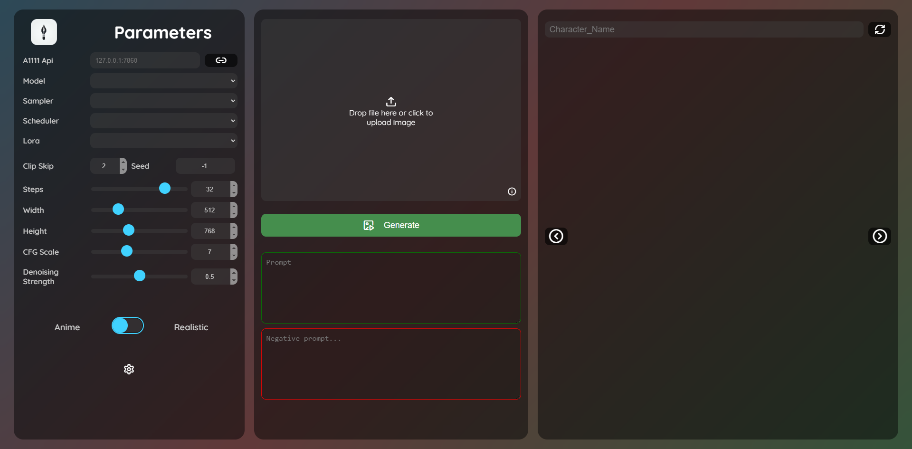
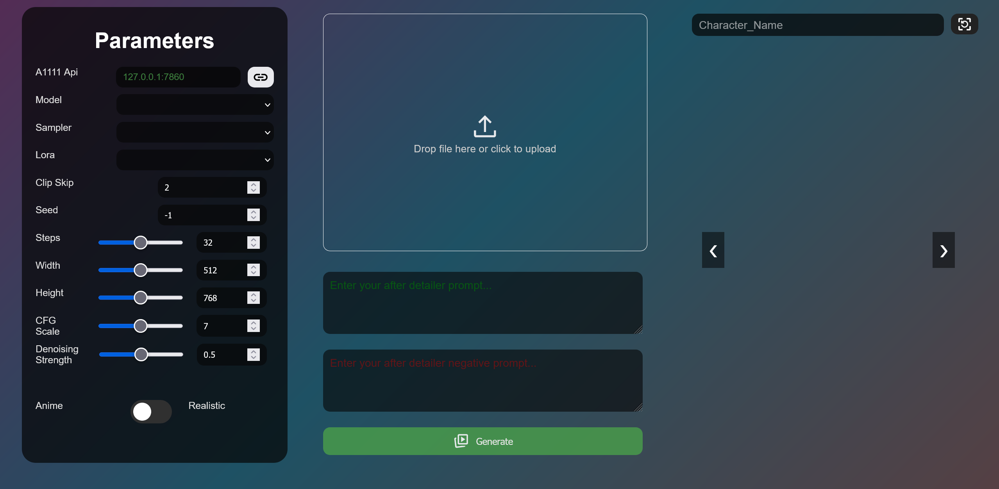

# Changelog

All notable changes to AutoExpress are listed here, newest first.

## Unreleased

### Changed
- **The WebUI connections run on [sdmux](https://pypi.org/project/sdmux/).** Detecting the WebUI, the transport (timeouts, retries, logins, tokens, extra headers), and each WebUI's session, login, upload, queue, download, progress and interrupt steps now come from the sdmux library (0.2.0), which started out as this code. AutoExpress keeps its face edit, instruction edit, animation and Live2D workflows and the capability checks with fixes on top. Detection also recognises Forge 2.x, and names Draw Things and stable-diffusion.cpp when they answer instead of calling them unknown. Interrupting a ComfyUI job only touches that job: a queued prompt is dropped, a running one interrupted.
- **The original interface at `/classic` catches up with the web interface.** It now has the Login section, model defaults with notes when a setting is changed to match the WebUI, the Illustration/Photo style, Change pose too, the intensity slider, Remove background, Animate with idle-motion suggestions, a progress bar and missing-LoRA notes, Retry and per-expression settings with export and import, the Live2D model kit, pasting an image, and a working Interrupt button.

### Docs
- **README and docs brought up to date, with new screenshots.** The README lists login for protected WebUIs, retrying one expression, the Live2D undress chain, touch reactions and the talking mouth, and drops a roadmap item that already shipped (poses). New screenshots of the current web interface, the Login section, the per-expression Retry dialog and the Live2D model kit dialog. The Live2D guide says the kit redraws the character in a T-pose by default (`--arm-angle`) and documents the puppet's scripting API (expressions, reactions, IK, `pose()`, visemes).
- **Animated sprites in the README and docs.** The README has an Animated sprites section with looping examples, and [docs/animated-sprites.md](docs/animated-sprites.md) shows more clips, frames from two loops, and how the endlessly looping WebP files keep playing in SillyTavern, browsers and other tools. The SillyTavern and RunPod guides explain where the looping sprites go, and the HTTP API table lists `lightning` with the current sampling defaults (20 steps, cfg 3.5).

### Fixed
- **Secrets stay out of logs and browser storage.** A URL with `user:password@` in it is no longer written to the log on a failed connect or kept in the browser's saved settings, error tracebacks no longer print local variables, and the connection settings hide passwords, tokens and headers from `repr()`. Extra headers are dropped when a redirect leaves the WebUI's host, and SwarmUI's `swarm_token` cookie only goes to the WebUI's host.
- **Live2D: the coat really comes off.** Qwen-Image-Edit sometimes recoloured the blazer (a white one where the beige one was) instead of taking it off. The coat-off edit now asks for the whole garment gone, collar, lapels and sleeves included, with the shirt's own sleeves showing, and the vision language model on ComfyUI (Qwen3-VL) checks the result: while it still sees an outer layer the edit is drawn again, up to twice. The RunPod setup starts ComfyUI with `--disable-dynamic-vram`, because ComfyUI's dynamic VRAM loading left Qwen3-VL's weights out when it writes text.
- **Live2D: shoes painted all over.** Stockings carried down into the shoes were drawn over them when the split put the footwear under the legwear, which hid the inner half of each shoe. Shoes are now always drawn over the stockings.
- **Live2D: no shadow streak under a raised arm.** The shade an arm casts on the jacket or shirt beside it is lifted onto its own layer: the cloth underneath is painted lit, and the shade fades out as the arm moves away from the body.
- **Live2D: the mouth and blush stay on the face as the head turns.** They took their depth from their own small layers, so turning the head left them behind (about 40 px for the mouth). They now take the face's depth under them.
- **Live2D: tongue and teeth in the visemes.** For th, d, t, l and n the tongue now shows raised between the teeth (it was lifted out of the opening and hidden). The upper teeth sit back a little for small openings, and the f, th, d and s shapes are retuned. Grief, relief, surprise and realization have corrected eye, brow and mouth settings, and the swap between the open and the closed eye is quicker, so no ghost of both lids shows.
- ComfyUI: a download the proxy in front of ComfyUI drops (a 404 or 5xx on a file that is there, as RunPod's proxy does now and then) is tried again, up to four times, instead of failing the whole job. A Live2D layer split downloads dozens of files, and one dropped file used to throw the split away.
- **Qwen-Image-Edit no longer picks Qwen-Image-Layered's VAE.** With both installed in ComfyUI, the edit took `qwen_image_layered_vae` (it sorts first), which burned any big change, such as a turned view, to near white. The edit now takes the Qwen-Image VAE the setup downloads.

### New
- **MCP server and an assistant skill.** `python -m autoexpress_mcp` lets any MCP-capable assistant or agent drive the standalone app over stdio or streamable HTTP: check and connect the WebUI, make, retry and fetch expressions, animate them, and build Live2D kits. [skills/autoexpress/SKILL.md](skills/autoexpress/SKILL.md) is a vendor-neutral guide that teaches any assistant the workflow and the rules, with or without MCP. Setup for common clients is in [docs/mcp.md](docs/mcp.md); install with `uv sync --extra mcp`.
- **Live2D: the undress chain, in the picture's own pose.** An opt-in way to build a kit's clothing (**Undress chain, picture's pose**, `"undress_chain": true`, `--undress`): the vision model on ComfyUI tags the visible garments outermost first (slot, colour, the regions they cover) and imagines the inner wear under them, and the undress order, the states, the half states and the layer count are worked out from that (a character without outer wear gets fewer layers). Each state is a Qwen-Image-Edit run that takes one garment off, lined up with the state before, colour-locked and pixel-locked: outside the removed garment's region every pixel is copied from the state before, and revealed skin is colour-locked to the face. Each garment, the inner top and bottom (each with its own switch) and the body become layers, and the half states (jacket slipped, shirt open, skirt lifted) keep only the garment's own pixels. The puppet keeps the picture's pose: no arm motion, breathing, idle sway and cursor follow, the 28 emotions with head-and-body reactions, and a boop on the nose, a pat on the head, a poke on the cheek and a tap on the body. `attach --fixed-pose` adds the same runtime to a Cubism model. The PSD hides the half-off art by default, and every image that shows inner wear or less is named `INTERNAL_` and kept out of previews and the contact sheet. See [docs/live2d.md](docs/live2d.md#undress-chain-the-clothes-from-the-picture-in-its-own-pose).
- **Retry a single expression, with its own prompt and settings.** A **Retry** button above the gallery makes the expression on screen again with a new seed. Its dialog can change that expression's prompt (the tags, or the whole edit instruction) and its seed, intensity, denoising, steps, CFG and negative prompt. With **Remember** on, they are saved with the character (`Output/<name>/autoexpress_overrides.json`) and every later run uses them. **Advanced: per-expression prompts and settings** edits all 28 at once, with **Export** and **Import** of the file. The API takes `"overrides"` and `"save_overrides"` on `POST /generate`, and has `GET`/`PUT /expression-overrides` and `POST /expression-prompt`. The SillyTavern extension redoes a sprite the character already has with a new seed.
- **Login for protected WebUIs, right in the app.** The WebUI Connection panel has a **Login** section under the URL: username (or InvokeAI email), password, token and **Extra headers** (for login proxies such as Cloudflare Access service tokens, also `AUTOEXPRESS_BACKEND_HEADERS`). It opens by itself when the WebUI refuses the request. The login is kept on the AutoExpress server and the page only ever learns which fields are set, never their values. Reconnecting to the same host (from the app or the SillyTavern extension) keeps it; it is never sent to a different address, and a login from the environment only goes to `AUTOEXPRESS_BACKEND_URL`'s host. ComfyUI's progress websocket now uses the same login, so the progress bar moves behind basic auth or a login proxy too.
- **Live2D puppets: real IK with elbow and knee hints.** `puppet.ik(limb, target, hint)` reaches a hand or foot to a point with a two-bone solver in 3D, the elbow or knee bending towards the hint point (by default out and down for an elbow, forward for a knee), within each joint's limits; `puppet.ikHint(limb, hint)` moves just the elbow or knee. Dragging a hand or foot uses it, and dragging the upper arm or thigh moves the hint. The joint limits are wider so the arms can wave, cheer and rest on the hips. The foot stays level as the leg moves.
- **Live2D puppets: motions move the whole body.** Every emotion's motion now has an arm gesture as well as the head (cheering, clasped hands, hands on hips, fists, a hand on the chest, a heart, a wave, arms hanging low), posed with the IK and listed under `gestures` and `gesture_for` in `live2d.json`. Motions are longer with short fades, so they no longer fade out before they show.
- **Live2D puppets as VTubers: face tracking and voice lip sync.** The puppet page has **Track my face**: MediaPipe's face tracker (loaded from a CDN when you press it) reads your webcam, and her head, body lean, blinks and winks, gaze, brows, smile and mouth follow you, mirrored like a mirror (**Mirror me** switches it off). **Recenter** takes your rest pose. **Lip sync from the microphone** opens her mouth with your voice, wider on bright sounds and rounder on dark ones, and learns the room's noise so a fan doesn't keep it open. For apps: `puppet.track(result)` takes a MediaPipe FaceLandmarker result (or ARKit-style blendshapes and a head matrix from any tracker), and `puppet.listen(stream or audio element)` lip-syncs a microphone or a TTS clip. When the tracker stops she goes back to idling.
- **Live2D puppets: real jiggle physics.** The bust, hips, hair and skirt are springs tuned in hertz with a damping ratio, the way Live2D Cubism's physics is set up, and they react to the model moving on screen (a hop, a step, a lean) as well as to the head and body angles. The bust hangs from the chest (its top barely moves, its lower curve swings most) and stretches as it drops, gravity follows the body's tilt, and every swing eases off at a soft limit instead of stopping hard. Hair hangs in locks that swing a little out of step, with the front and back hair swinging together so the back hair never slides out from under the front. Skirts swing by how much they flare: a pencil skirt hugs the legs, a flared skirt swings freely. The settings are `Rig.Physics` in the puppet file.
- **Live2D: a talking mouth with separate teeth and tongue.** The mouth-open drawing now shows both rows of teeth and the tongue. The segmentation model (SAM 3) cuts it into five layers: Mouth lips, Teeth upper, Teeth lower, Tongue and Mouth inside. The puppet player moves them to make the 15 standard TTS visemes (the Azure / Oculus set), with the teeth and tongue clipped to the opening, through three new parameters: `ParamMouthWide`, `ParamTongueUp` and `ParamTeeth`. `puppet.viseme(name)` shows one shape, for a TTS engine's viseme events. `puppet.speak(text)` mouths a line from its letters, or plays a viseme timeline. The preview page has a Say box.
- **Live2D puppets: cleaner arms with the coat off or half off.** With SAM 3.1 the kit also outlines the character in the coat-off edit, so on a white shirt the background closed in between an arm and the body no longer hangs beside the body as white bars when the arms rise; and it outlines the coat in the half-off edit, so the slipped coat no longer brings the shirt's redrawn upper arms (or bare shoulders) along as a pale smear. The side of a top painted in behind a raised arm is spread from the cloth's lit colours, not from the arm's shadow and outline.
- **Live2D puppets: the outer garment by name.** The kit names the character's outermost garment (a haori, a cloak, a cape, a hoodie as well as a blazer) and SAM 3.1 and the coat edits look for that: what you type in **Outer garment** (or `none`), else what the description, character card or prompt data says, else what a vision language model on ComfyUI sees (Qwen3-VL 8B through ComfyUI's own TextGenerate node, now in the RunPod setup script). The manifest records the name, where it came from and the clothes the model saw.
- **Live2D puppets: coat and sleeves found with SAM 3.1.** When ComfyUI has SAM 3.1 (now in the RunPod setup script), the kit finds the coat and each of its sleeves by name instead of comparing the picture with the coat-off edit and asking Qwen-Image-Edit to paint the sleeves. The coat layer takes the coat's exact outline (with its drawn line, which stayed on the shirt as a pale rim), the sleeves come off whole with the arms, and the coat's shadow on the skirt comes off with the coat, so with the coat off the skirt is lit cloth. A dropped request to a remote ComfyUI is retried.
- **Live2D puppets: no notch at the armpit.** In the rows the sleeve map paints, a sleeve now ends at its painted inner edge (plus its outline, up to the gap beside the body): the cut along the drawing's lines also took a strip of the jacket's side there, which left a notch at the armpit when the arm rose.
- **Live2D puppets: sleeves cut from a map, straight arms, narrower shoulders.** One more Qwen-Image-Edit run paints the outer garment's sleeves flat magenta (`sleeves.png` in the kit), and each sleeve comes off with its arm exactly where the map paints it, so raising an arm no longer leaves a strip of sleeve or shadow on the jacket's side. The A-pose stick figure has narrower shoulders, the redraw asks for straight arms and, with DWPose, asks again when an elbow is bent, so the jacket's sleeves and the shirt's arms with the coat off line up. With the coat off the shirt's sleeves reach the wrists (below the waist they went to the skirt and the arms showed bare from the elbow down), and no coat-coloured patches stay on the shirt along the coat's edges.
- **Live2D puppets: natural face, whole sleeves, the skirt as drawn.** The face's skin is the picture's own wherever it shows, with the drawn jaw line, and plain skin spread in under the eyes, mouth and fringe; the split's repainted face (flatter, greyer, with a pale rim) made it look like a mask. The A-pose redraw follows an OpenPose A-pose stick figure (given to Qwen-Image-Edit as a second picture), so the arms come out clear of the body; it still asks again when they lie against it. A sleeve is cut at its mirrored width (its outer edge reflected across the arm's bone), not at the first fold beside the arm, and no specks of its outline stay in the air when the arm moves. Taking the coat off no longer swaps in the edit's redrawn skirt (a waistband and seams the drawing didn't have): under the jacket's hem the skirt is plain cloth in its own lit colour, the jacket's shadow comes off with the jacket, and the shirt's hem fills the waist so no gap opens. The slipped coat keeps out the bare shoulders the edit draws under it (told from the body edit, so a pale coat isn't taken for skin), stockings no longer fill the arch under a heel, and the body layer drops the edit's white background shut in between an arm and the hip (a pale halo round the arms with the coat off).
- **Live2D puppets: drawn half-off clothes and cleaner posing.** Half-off states are drawn again: Qwen-Image-Edit slips the coat off the shoulders, opens the top and lifts the skirt (with the inner wear), because a garment faded out where it comes off can't show the cloth's new shape. Turning or nodding the head keeps it nearly in one piece, so the back hair no longer swings out past the head as a lump and the fringe stays on the face. A sleeve is cut from the jacket along the outline drawn between them, so moving an arm leaves the jacket's front on the chest. Small holes the split leaves in clothes (where a hand lay over the jacket's hem) are painted in, stockings carry on down into the shoes so no gap opens above them, and the A-pose redraw asks for straight, parallel legs with the knees over the ankles, and asks again (up to three times) when the feet stay together or crossed. With DWPose in ComfyUI (comfyui_controlnet_aux, now in the RunPod setup script) the skeleton's joints come from the detected pose (`pose.json` in the kit). Grey smudges the split leaves on pale skin are painted over from the picture (pale skin on a white background was taken for background).
- **Live2D puppets: depth.** See-through already estimates the depth of every layer, hidden parts too; the kit now keeps it (`depth/` in the kit) and the puppet gives every mesh point its depth. Turning the head or the body is a small rotation: the nose and fringe move further than the cheeks, the back hair goes the other way, and the shoulders turn with the chest. The view stays the picture's; nothing new is drawn. With it the skeleton works in 3D: the spine, arms and legs also swing a little towards or away from the viewer (`ParamBone<Name>Swing`), each point moving at its own depth, and an arm swung back goes behind the body.
- **Live2D puppets: full-body skeleton for natural motion.** The kit first redraws the character standing in a neutral A-pose, full body (one Qwen-Image-Edit run; `--no-neutral-pose` keeps the picture's pose), so nothing is hidden behind the arms. The puppet then gets a skeleton fitted to the drawing (hips, spine, chest, neck, head, and upper arm, forearm, hand, thigh, shin and foot on each side), one `ParamBone<Name>` parameter per bone, kept to small, natural motion so the clothes never tear. Whole sleeves move with the arms, the weights blend across the shoulder and hip seams so the cloth stretches there instead of splitting, a skirt (and its half-off state) stays whole while the legs move under it, the body behind a hand is painted in, a top's sides are drawn on behind the arms so lifting one shows no gap, touching legs are split along the line drawn between them, and dragging a hand or foot moves the limb with inverse kinematics. Backgrounds are removed with BiRefNet (cleaner hair, no white specks). Taking off the legwear no longer leaves stockings or a shoe behind, the coat layer no longer takes in shoes.
- **Live2D puppets: drawn pieces for strong emotions, stronger motion.** Three more Qwen-Image-Edit runs draw furious brows, a wide grin and teary eyes, switched by `ParamBrowAngry`, `ParamMouthGrin` and `ParamTear` and used by anger, joy, sadness, grief and others; they move with the rig like the brows and mouth they replace. Every edit is lined up with the picture first (Qwen hands edits back a little zoomed and shifted, which put cut-out pieces beside the features they replaced). Reactions are about twice as big and the whole body joins in, and the expressions go further. The default inner wear is matching lace lingerie. Blinks and motions keep real time when the frame rate drops (eyes no longer stay shut for seconds), the torso leans the way it's dragged, and arms are grabbed anywhere and turn at their joint.
- **Live2D puppets: Koikatsu-style clothing, posing and reactions.** Clothes are dressed in slots (coat, top, bottom, legwear, inner top, inner bottom), each on, half off or off: two Qwen edits put the coat on its own layer with a slipped-off-the-shoulders state, and with the inner wear two more draw the top opened and the skirt lifted. Dragging the head, an arm or the torso poses the skeleton within joint limits; the bust and hips pull only as far as they stretch. Taps on the face, head, chest, hips and body play reactions from the puppet's emotions, mapped for the SillyTavern Live2D extension, and the AutoExpress extension plays each message's emotion on puppets whatever classifier Character Expressions uses (the Live2D extension only knew the local and Extras ones). Blinks swap to a cleaned-up closed-eye art (skin and lashes, feathered), smiles close the eyes into arcs, the eyes and mouth get upscaled textures, the blush is feathered, stray specks are dropped from the clothing layers, the chin See-through leaves in the neck layer is cut out (it showed as a second jaw line) and an arm raised beside the head keeps its skin under the clothes.
- **Live2D clothing one piece at a time**: the inner wear is split into top and bottom layers, and puppets get half-off outfits (top off, bottom off, topless, either inner piece off) with a switch per piece. Accessories are their own switchable layers (`ParamAccessories`). **Outfit** dresses the character in what you type before the split, and the clothing in the picture's prompt metadata (A1111, Forge, SD.Next, ComfyUI, InvokeAI, NovelAI) fills in the inner wear and is checked with the description. The blush now follows the slant of the face.
- **Live2D puppets: swappable clothing, soft body physics and mouse pulls.** With **Swappable clothing** on (drawn adult characters only, with an explicit adult confirmation; photos and child-coded descriptions are refused), the kit draws the body under the clothes and the body in inner wear with Qwen-Image-Edit and the puppet stacks body, inner wear and outer clothes, switched by `ParamClothesOuter` / `ParamClothesInner` and `outfit_full` / `outfit_inner` / `outfit_nude` expressions that stay on while emotions change. Puppets now have bust and hip jiggle (`ParamBustX/Y`, `ParamHipX/Y`), skirts and ribbons that swing, cloth, hair and soft parts that can be dragged and poked, expression changes that glide, and a blush with anime hatching.
- **Cleaner Live2D layers at higher resolution**: layers are split at 2048 px by default (small pictures upscaled first, with ComfyUI's upscale model when there is one); skin, clothes and hair are made opaque, clothing over the neck where the picture shows the neck is cut away, visible colours are matched to the picture, and the hair colour is painted under the bangs so swaying hair never shows the scalp.
- **[AGENTS.md](AGENTS.md)**: a guide for AI coding agents and assistants: what each feature needs, the WebUI backends, deploying ComfyUI on a rented GPU (RunPod scripts, CLI, API), driving the HTTP API, and the project's conventions.
- **Ready-to-play Live2D puppets**: every Live2D model kit now also has a puppet that plays straight away, no Cubism Editor needed. It is the kit's layers with a rig AutoExpress works out from them (head turns and tilts with depth, blinking with the eyes-closed art, eye movement, brows, mouth shapes and the mouth-open art, blush, breathing, hair that sways), in an open format (`<name>.puppet.model.json`). The AutoExpress SillyTavern extension lets the SillyTavern Live2D extension load puppets like Live2D models, so the 28 expressions, their motions, the idle loop, hit areas, lip sync and cursor following all work, already mapped to the emotions. **Puppet (.zip)** and **Try the puppet** in the web app, and `python -m autoexpress_core.live2d puppet <kit folder>` for kits made earlier. See [docs/live2d.md](docs/live2d.md#ready-to-play-puppet).
- **Live2D model kits**: pictures of a character in, the source of a Live2D model out. See-through (on ComfyUI) splits the best picture into up to 23 layers with the hidden areas painted in, and AutoExpress names and groups them for Live2D Cubism Editor, adds eyes-closed and mouth-open art from two edits (with the character's LoRA from Civitai when the WebUI has it), and checks the pictures with advice on which ones work. The kit also has a flat See-through PSD for browser auto-riggers, and expressions and calm reaction motions for the 28 emotions. `python -m autoexpress_core.live2d attach <model folder>` adds those to any rigged Cubism model and writes `sillytavern_settings.json`, so the SillyTavern Live2D extension plays each emotion without setup. **Tools > Live2D model kit** in the web app, `POST /live2d`. See [docs/live2d.md](docs/live2d.md).
- **Animated sprites**: every expression can become a short looping animation. Each still is animated with Wan 2.2 image to video 14B on ComfyUI, using the still as the first and last frame so the clip loops. Saved as animated WebP (and optionally APNG or GIF) next to the PNGs. With Remove background on, the clips are transparent: the still is animated on a flat key color and every frame is cut out again, with the alpha smoothed over time and the key color taken out of the edges. **Animate sprites** in the standalone app, **Animate** in the SillyTavern extension, `"animate": true` on `POST /generate`, and `POST /animate` to animate stills already saved. The clips are silent reactions to the chat: the character never talks or moves the lips (stills made for animation keep the mouth closed, and clips are sampled in full so the negative prompt applies; **Fast** uses the 4-step LoRAs), and the motions stay small and calm. See [docs/animated-sprites.md](docs/animated-sprites.md).
- **Character cards**: a SillyTavern / Tavern card PNG (V1, V2 or V3) can be the input image. Its name becomes the output folder, and its persona writes the **idle animation** (the neutral clip): breathing, blinking and a gesture that fits the character. It can also come from the character's wiki page or from any OpenAI compatible LLM (`AUTOEXPRESS_LLM_URL`, `AUTOEXPRESS_LLM_MODEL`, `AUTOEXPRESS_LLM_API_KEY`), or be typed in. `POST /character-card` reads a card.
- `python -m autoexpress_core.animation download <ComfyUI folder>` fetches the Wan 2.2 files, and the setup checklist lists what's missing.
- **RunPod guide**: [docs/runpod.md](docs/runpod.md) lists the pod image, GPUs and every model AutoExpress uses (with NSFW-capable checkpoints), and `scripts/runpod/` has a script that creates a pod and one that installs ComfyUI with everything on it.

### Changed
- Anger and fear are toned down for chatbot sprites: anger is a firm frown with the lips pressed (no bared teeth) and fists at the sides, fear is a frightened look with the hands held to the chest.

## 2.2.0 (2026-10-31)

### New
- **SillyTavern extension**: install AutoExpress in SillyTavern from this repo's URL and press **Generate expression sprites** to make a character's sprites from its avatar or another image. It drives the standalone app (and whichever WebUI that's connected to, local or remote), and each finished expression goes straight into the character's Character Expressions folder. Options for the checkpoint, prompt style, method, intensity, background removal and poses, a **Missing** button that picks only the expressions the character has no sprite for, progress with Cancel, and a `/autoexpress` command. See [docs/sillytavern.md](docs/sillytavern.md).
- The standalone app's API can be called from other web pages listed in `AUTOEXPRESS_CORS_ORIGINS`, which allows SillyTavern's default address (`http://localhost:8000`, `http://127.0.0.1:8000`) out of the box.
- **Poses**: change the pose along with each expression, for visual novel and chatbot sprites. Each of the 28 expressions has a small gesture that starts from the character's current pose (hands on the hips for anger, leaning in with the hands behind the back for curiosity), keeping the outfit, framing and background. Made with Qwen-Image-Edit on ComfyUI: in one edit with the instruction edit mode, or as a pose edit before face inpainting. A `pose` input on the Edit Instructions node, **Change pose too** in the standalone app and `"pose": true` on `POST /generate`.

### Changed
- **The Next.js web interface is always the default.** A source install without Node.js now downloads the prebuilt interface from the GitHub release (`autoexpress-frontend.zip`, published with each release) on first start, instead of falling back to the classic page. A build made with `install` is kept, and a downloaded one is replaced when AutoExpress is updated. `AUTOEXPRESS_DOWNLOAD_FRONTEND=false` turns it off.
- **Anime expressions**: the Danbooru, Pony and Illustrious tags and the sprite poses were tuned against a hand-drawn reference sprite set. Love no longer forces heart-shaped pupils, gratitude keeps the eyes open, grief shows teary eyes instead of sobbing, fear and realization get wavy open mouths, and small manga marks (anger vein, sparkle, flying sweatdrops) appear where they fit. Poses keep the hands off the face, so face inpainting still finds it after the pose edit.

### Security
- minimatch 11.0.3 for the frontend's lint tools (GHSA-g3hv-75wg-m249, a denial of service through brace expansion). It is only used while developing and is not in the built app.
- Pillow 13.0.0 and rembg 2.0.86 in `uv.lock`, fixing 41 Pillow advisories (heap overflows in the JPEG, TIFF and FlashPix decoders, the Ghostscript argument injection, decompression bomb bypasses and others) and 3 rembg advisories (SAM model injection, SSRF and path traversal in custom model loading).
- The standalone app now needs Python 3.11 or newer, since the fixed Pillow and rembg releases no longer support 3.10. The WebUI extension and nodes still work on Python 3.10.

## 2.1.1 (2026-10-24)

- **macOS releases**: `autoexpress-<version>-macOS_Release.zip` for Apple silicon (macOS 14+) and `autoexpress-<version>-macOS-Intel_Release.zip` for Intel Macs, started with `./run.sh`. The Intel build has no Remove background, since onnxruntime isn't built for Intel Macs.
- Dependencies live in `pyproject.toml` and `requirements.txt` is gone: `dependencies` for the WebUI extension and nodes, a `standalone` extra for the app and a `dev` group for tests. `uv.lock` pins every package with hashes and platform markers.
  - The release zips, the Docker image and `install` (when [uv](https://docs.astral.sh/uv/) is installed) install exactly the versions in `uv.lock`, picking the right wheels for each OS and CPU. Without uv, `install` uses `pip install -e ".[standalone]"`.
  - Installing AutoExpress into ComfyUI from git no longer pulls the standalone app's dependencies (Flask, rembg, ...) into ComfyUI.
- Release zips bundle their own Python (3.13, in `runtime/`), each built on its own platform from prebuilt wheels only, so a missing wheel fails the build instead of shipping a zip that doesn't start. Before, the zips carried a virtual environment that pointed at the build machine's Python.
- `run` and `run_debug` use the bundled Python when it's there, and `.venv` otherwise. On macOS they clear the download quarantine on the bundled Python.
- Each release zip is smoke tested (the app starts, serves the web interface, and Remove background is available where it should be) before it's published.
- Zip names keep the version as tagged, e.g. `autoexpress-v2.1.1-Linux_Release.zip`.
- The dependency audit checks the versions pinned in `uv.lock`, and Dependabot updates `uv.lock`.

## 2.1.0 (2026-10-24)

### New
- **Instruction edit mode** on ComfyUI: Qwen-Image-Edit changes the expression from one sentence instead of inpainting the face. Tuned illustration and photo wordings for all 28 expressions, an Edit Instructions node, readiness checks and an example workflow that needs only core nodes.
  - Photos use Qwen-Image-Edit-2511 at 40 steps and CFG 4, and only the edited face is pasted back onto the original through a feathered mask, so the rest of the photo is untouched.
- **Expression intensity** slider (0 to 1) with a default per model family: inpainting with expression LoRAs for anime families, instruction edit with photo wording for realistic and natural-language models.
- The standalone app works with a WebUI hosted anywhere (LAN, RunPod and other hosts, https, reverse-proxy sub-paths, logins). Nothing assumes it runs on this machine.
  - **Detect automatically** (the new default) reads the WebUI type from its API: A1111, Forge, SD.Next, ComfyUI, SwarmUI or InvokeAI.
  - After connecting, a setup check lists what the WebUI has and what's missing (ADetailer and its face model, Impact Pack and Subpack, face detection models, checkpoints, samplers, LoRAs). Each missing piece comes with steps for that WebUI, commands to copy, links, and a **Re-check** button. Also at `GET /backend/capabilities`.
  - Connection errors say what to try: `--listen`, the host's proxy URL, or the login.
  - A RunPod proxy URL for a port the pod doesn't expose says to add the port under Expose HTTP Ports.
  - Expression LoRAs you renamed on the WebUI are recognised by the hashes in their metadata (A1111 family, InvokeAI with sha256 hashing).
  - Expression LoRAs are written to the LoRA folder only when it's on this machine. InvokeAI installs missing ones itself through its Model Manager. For other WebUIs, the run lists each missing LoRA with its download link (`notes` on the job).
- **Remove background** in the standalone app saves every expression with a transparent background, only the character is kept. Uses rembg (`isnet-anime` for drawn characters, `u2net_human_seg` for photos), installed from `requirements.txt`. Also `"remove_background": true` on `POST /generate`, and `GET /background-removal`.

### Changed
- The expression LoRA base (SD 1.5, SD 2, SDXL, Flux) is read from the model itself instead of guessed from the checkpoint name, so SD 1.5 checkpoints with unusual names no longer get SDXL LoRAs. The name still tells Pony and Illustrious apart from plain SDXL.
- LoRA entries can set a weight per expression (0 drops the LoRA and its trigger). The Illustrious expressions LoRA is skipped for anger, and the Illustrious family recommends NoobAI-XL, WAI and other finetunes over base Illustrious-XL 0.1.
- `install.sh` / `install.bat` build the web interface too (Node.js 20.9+, pnpm or corepack), check for Python 3.10+, reuse `.venv` unless `--clean` is given and accept `--skip-frontend`. `install.sh` no longer runs `apt update/upgrade`, so it works on macOS.
- `run` / `run_debug` check that the app is installed and start from their own folder. `run_debug` listens on 127.0.0.1 by default, since the Werkzeug debugger can run code.
- The Docker image runs as an unprivileged user (uid 1000). A mounted results folder needs to be writable by it. `--build-arg PRELOAD_REMBG_MODELS="..."` bakes background removal models into the image.
- The frontend, release zips and Docker image build on Node 26 (the Docker image installs pnpm with npm, since corepack is gone).
- Release notes come from this changelog.
- Each release publishes the Docker image to `ghcr.io/deepratna-awale/autoexpress`. The Docker Hub image is no longer updated.
- matplotlib is no longer a dependency.
- README and docs restructured, with a page per integration under [docs/](docs/).

### Security
- Option values and labels are escaped in the classic interface, the LoRA tag parser runs in linear time, and release jobs get minimal permissions.
- Dependabot and a weekly dependency audit (pip-audit and pnpm audit); sd-parsers 0.6 and higher requirement floors.

## 2.0.0 (2026-10-23)
- New web interface built with Next.js and shadcn/ui (in [frontend/](frontend/)). Flask serves it at http://127.0.0.1:5000 once it is built; the original interface stays at `/classic`.
  - Resizable panels, mobile layout, light/dark mode and a theme editor with presets (saved in the browser).
  - LoRA picker with a strength per LoRA, live gallery that fills in while expressions generate, raw metadata viewer.
  - Shows the Prompt Style and WebUI backend selectors when the backend supports them.
- Release zips and the Docker image include the built interface.
- Expression prompts now come in one set per model family: Danbooru, e621, Pony, Illustrious/NoobAI, SDXL/SD1.5 (CLIP) and natural language (Flux, SD3, ...).
- The Anime/Realistic switch is replaced by a **Prompt Style** dropdown. **Auto** picks the family from the checkpoint name.
- Family quality tags (e.g. Pony `score_` tags) and negatives are added only when missing from your prompt.
- Expression LoRAs matched to the checkpoint (Pony, Illustrious/NoobAI, SDXL, SD1.5, Flux) are added to the prompt, and downloaded from Civitai into the WebUI's LoRA folder when they're missing.
- The standalone app can now drive other WebUIs, picked from a new **WebUI** dropdown: AUTOMATIC1111, Forge / reForge, SD.Next, ComfyUI (FaceDetailer), SwarmUI (`<segment:face>`) and InvokeAI (face mask inpainting).
  - New `GET /backends` route, and `POST /receive_data` takes an optional `backend` id.
  - A1111 style requests drop built-in scripts the server does not have, so Forge and SD.Next no longer reject them.
  - `/generate` reports why a WebUI is not ready (API unreachable, ADetailer or Impact Pack missing, no models).
- Standalone app hardened for production:
  - Timeouts, retries with backoff, basic/bearer auth (and SwarmUI / InvokeAI logins) for every WebUI, with typed error codes shown in the UI.
  - Generation runs as a queued background job: `/jobs`, `/jobs/<id>`, `/jobs/<id>/cancel`, live progress on the Generate button, no overlapping runs.
  - `/health` and `/backend/status` (reachability, readiness, version).
  - `/generate` checks the WebUI before queueing and answers failures with a matching HTTP status (503 unreachable, 504 timeout, 401 auth, 409 not ready, 502 rejected).
  - Step progress on A1111, Forge and SD.Next during the ADetailer pass.
  - Reuses the Civitai key the selected WebUI already has (Civitai Browser+ / Civitai Helper, ComfyUI LoRA Manager) when none is entered.
  - ComfyUI: softer FaceDetailer blending (no paste seam over the hair), and saved PNGs carry A1111 style parameters.
  - Input validation on `/generate` and `/upload`; output folder names can no longer escape the output directory, and `/images/..` is blocked.
  - Configuration through `AUTOEXPRESS_*` environment variables, JSON logs and request ids, `python -m autoexpress` serves with waitress, Docker health check.
- AutoExpress now runs inside other WebUIs:
  - **AUTOMATIC1111 / Forge / reForge / SD.Next extension**: an AutoExpress tab that runs ADetailer in-process, so `--api` is not needed. It reads prompt, sampler and seed from the uploaded image and can build a sprite sheet.
  - **ComfyUI nodes**: Expression Prompts, Expression Prompt, Expression LoRAs, Save Expressions and Sprite Sheet, used together with Impact Pack's FaceDetailer.
  - **InvokeAI node**: Expression Prompts.
- Expression prompt sets, expression LoRAs, payloads and the generation loop moved into a shared `autoexpress_core` package that every integration uses.
- Fixed the Interrupt button in the standalone app, which raised an error instead of stopping generation.
- The base prompt and expression prompt are now joined with a comma.
- The seed setting now reaches A1111 1.9+ (it was overridden by the built-in Seed script).

## 2024-11-13
- Docker image available here: [AutoExpress on DockerHub](https://hub.docker.com/r/deepratna/autoexpress)
- Added Logo to UI
- Added Scheduler dropdown
- Added info icon to UI
  - Whenever you hover on the image or the info icon, it will show the raw generation data for convienience.
- Added Settings cog to have a modal for infrequently used settings.
- If element does not exist in dropdown (Model, Sampler, Scheduler, Lora), a new dropdown element is created.

**Avery Contributions**
- Boiler plate Theming Support by modifying [main.css](autoexpress/static/stylesheet/main.css)
- Implemented Gradient pause feature for performace increase.
- Expression jsons are now in different flavours instead of only being Anime/Realistic.
- 

## 2024-09-26
- Tested on Ububtu (22.04.3 | jammy)

## 2024-06-23
- Added revamped UI

- Removed my custom logger and added loguru library.

