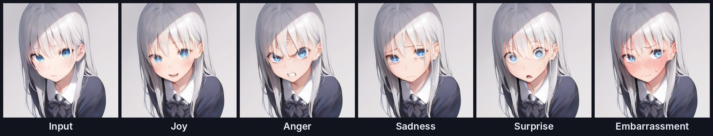
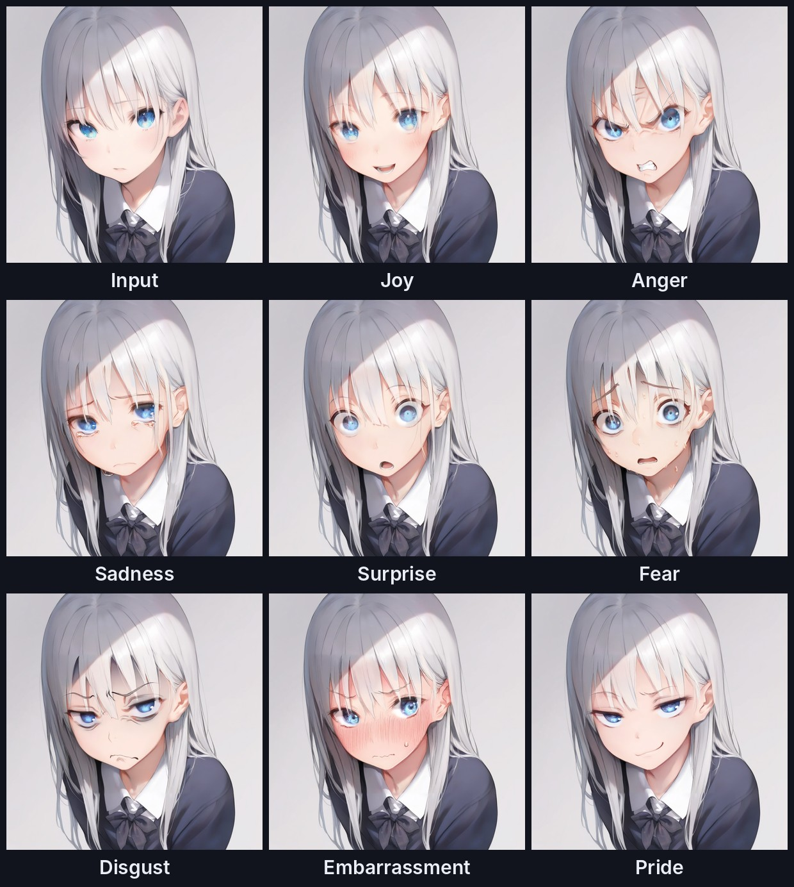
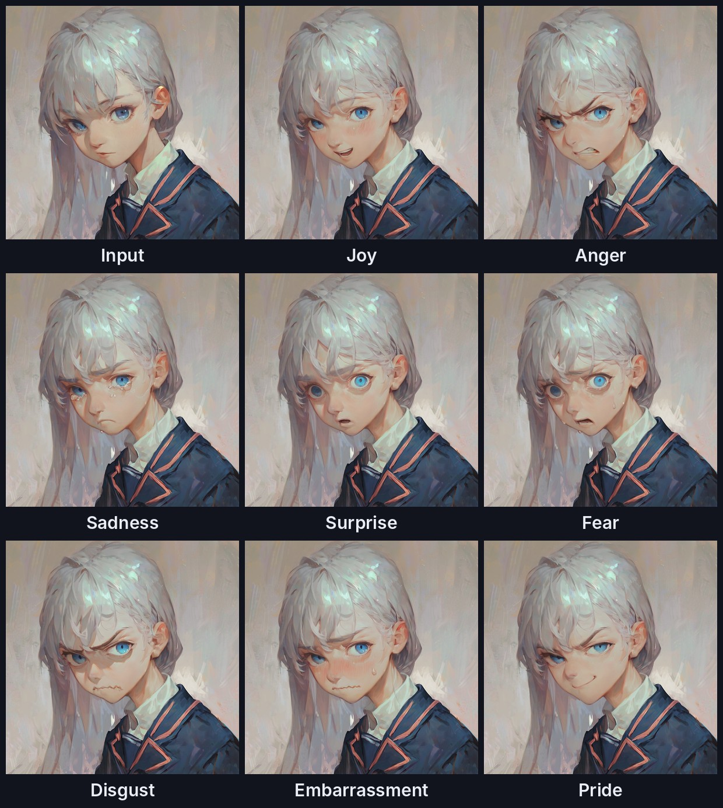
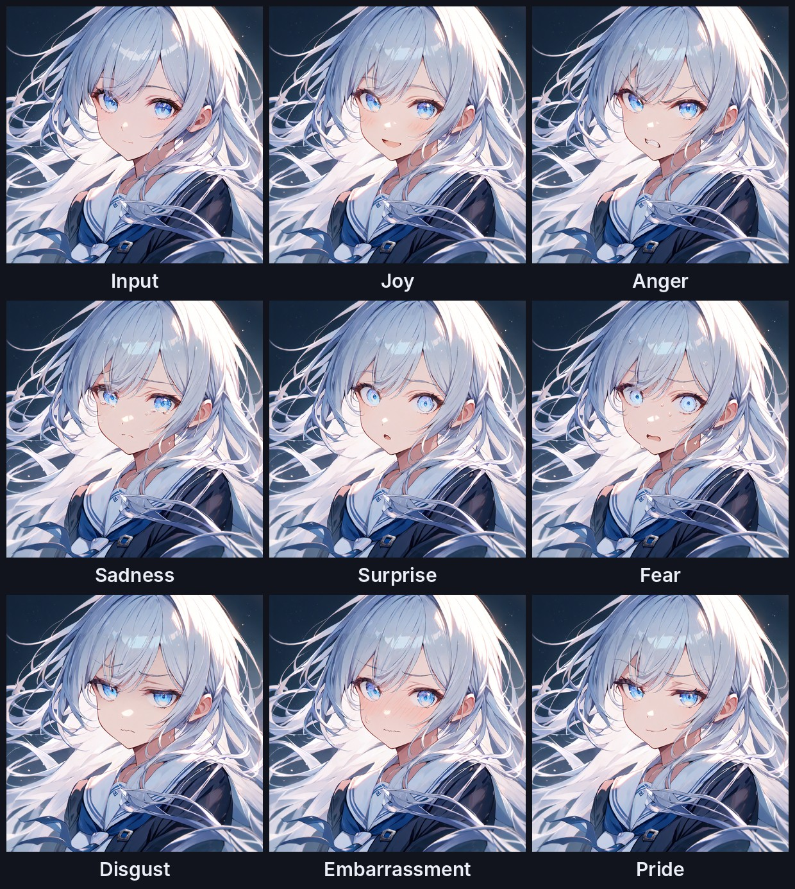
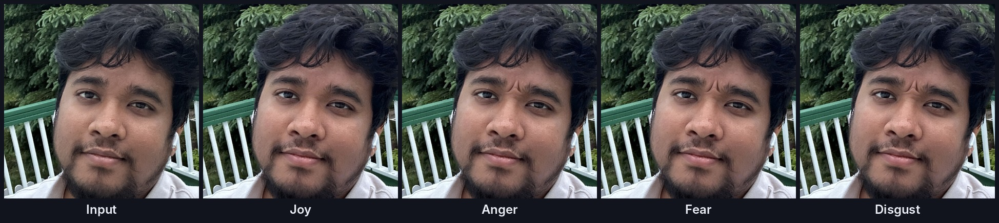
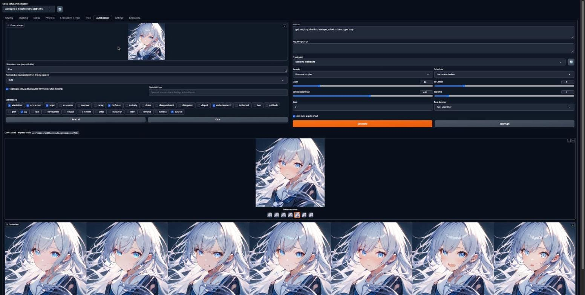
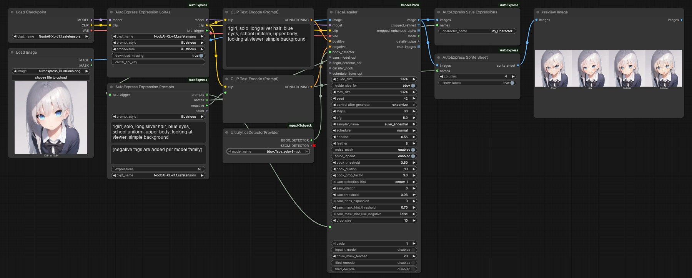
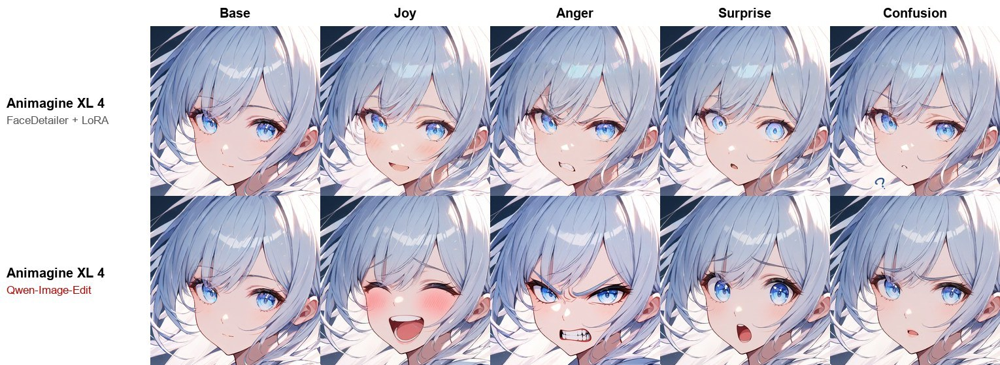
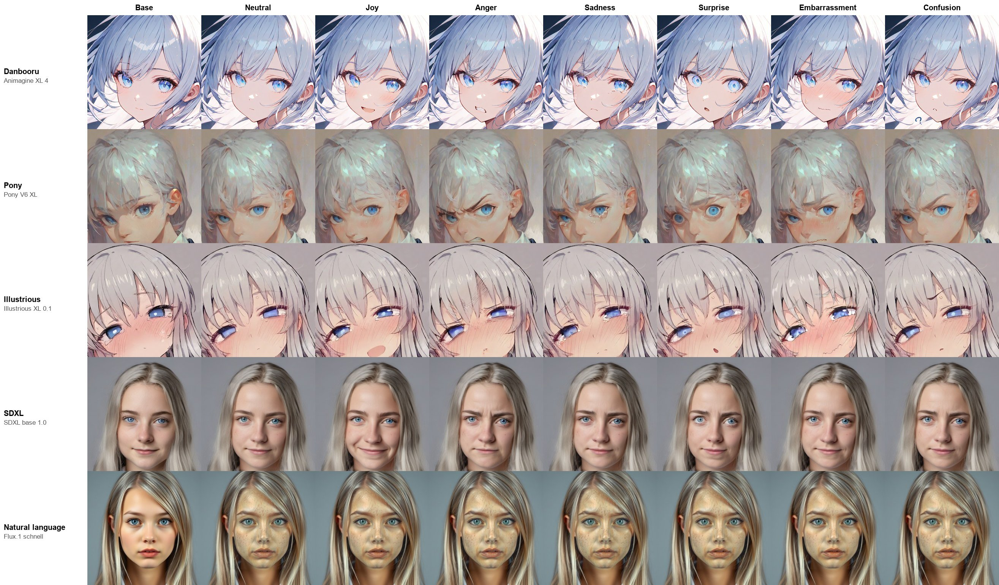
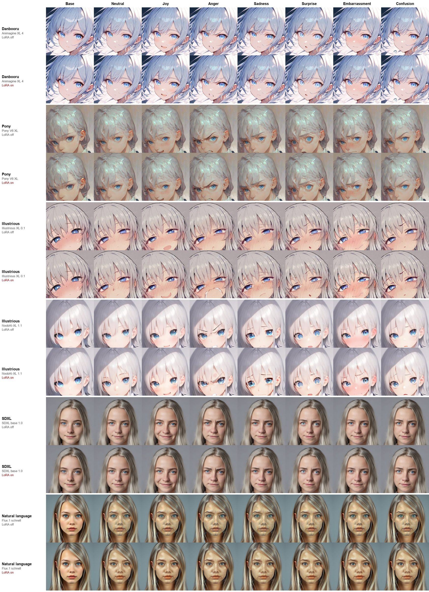

<h1> AutoExpress</h1>

**One character image in, a full set of 28 facial expressions out.**

AutoExpress repaints your character's face with 28 different emotions while keeping everything else (pose, outfit, background, art style) the same. It's made for expression sprites, for example for [SillyTavern](https://github.com/SillyTavern/SillyTavern) character cards and visual novels.

It runs where you already generate images:

- as an **extension** for AUTOMATIC1111, Forge, reForge and SD.Next,
- as **custom nodes** for ComfyUI (and SwarmUI) and a node for InvokeAI,
- or as a **standalone app** that drives any of those WebUIs over their API.

It ships expression prompts tuned for each model family (SD1.5 anime, Pony, Illustrious/NoobAI, SDXL, Flux and more) and downloads matching expression LoRAs for you.

  

For the latest changes, see the [Change Log](Changelog.md).

## Contents

- [Expressions](#expressions)
- [Examples](#examples)
- [Install](#install)
  - [AUTOMATIC1111 / Forge / reForge / SD.Next](docs/a1111.md)
  - [ComfyUI](docs/comfyui.md)
  - [InvokeAI](docs/invokeai.md)
  - [Standalone app](docs/standalone.md)
- [Instruction edit mode](#instruction-edit-mode-comfyui)
- [Expression intensity](#expression-intensity)
- [Prompt styles](#prompt-styles)
- [Expression LoRAs and your Civitai key](#expression-loras)
- [Using the results with SillyTavern](#using-the-results-with-sillytavern)

# Expressions

| Emotion       | Emotion        | Emotion     | Emotion     |
| ------------- | -------------- | ----------- | ----------- |
| Admiration    | Amusement      | Anger       | Annoyance   |
| Approval      | Caring         | Confusion   | Curiosity   |
| Desire        | Disappointment | Disapproval | Disgust     |
| Embarrassment | Excitement     | Fear        | Gratitude   |
| Grief         | Joy            | Love        | Nervousness |
| Neutral       | Optimism       | Pride       | Realization |
| Relief        | Remorse        | Sadness     | Surprise    |

You can generate all of them or just the ones you pick.

# Examples

Each sheet is one input image and eight of its expressions, generated at 1024×1024 with the matching [prompt style](#prompt-styles) and [expression LoRA](#expression-loras). Click a sheet for full size.

<table>
  <tr>
    <th>NoobAI-XL (Illustrious)</th>
    <th>Pony V6 XL</th>
    <th>Animagine XL 4 (Danbooru)</th>
  </tr>
  <tr>
    <td width="33%"></td>
    <td width="33%"></td>
    <td width="33%"></td>
  </tr>
</table>

Every run can save a labelled sprite sheet like these next to the individual images.

Photos work too. On a real face AutoExpress keeps the change deliberately small, so it still looks like the same person. This set was made from a selfie with the [instruction edit mode](#instruction-edit-mode-comfyui) at the photo default [expression intensity](#expression-intensity) of 0.1:

  

---

# Install

Pick the way you already work. All of them share the same expression prompts and generation logic (`autoexpress_core`), and inside a WebUI AutoExpress runs in-process like any other extension, so the WebUI doesn't need `--api`.

| You use | AutoExpress shows up as | Quick install | Guide |
| --- | --- | --- | --- |
| AUTOMATIC1111, Forge, reForge, SD.Next | **AutoExpress** tab, faces repainted by [ADetailer](https://github.com/Bing-su/adetailer) | **Extensions → Available**, search **AutoExpress**, or **Install from URL** with this repo's URL | [docs/a1111.md](docs/a1111.md) |
| ComfyUI (and SwarmUI) | **AutoExpress** nodes around [Impact Pack](https://github.com/ltdrdata/ComfyUI-Impact-Pack) FaceDetailer | ComfyUI Manager, or `comfy node install autoexpress` | [docs/comfyui.md](docs/comfyui.md) |
| InvokeAI | **AutoExpress Expression Prompts** node | **Nodes → Git Repository URL** with this repo's URL | [docs/invokeai.md](docs/invokeai.md) |
| Any of the above, from outside | Standalone web app on port 5000 that drives the WebUI over its API, locally or on a remote GPU | [Release zip](https://github.com/deepratna-awale/AutoExpress/releases) or `docker run -p 5000:5000 deepratna/autoexpress` | [docs/standalone.md](docs/standalone.md) |

Fooocus has no extension system, so it isn't supported.

<table>
  <tr>
    <td width="50%"> AutoExpress tab in AUTOMATIC1111</td>
    <td width="50%"> AutoExpress nodes in ComfyUI</td>
  </tr>
  <tr>
    <td colspan="2"> Standalone web interface</td>
  </tr>
</table>

# Instruction edit mode (ComfyUI)

Besides repainting the face with ADetailer or FaceDetailer, AutoExpress can change the expression with [Qwen-Image-Edit-2509](https://huggingface.co/Qwen/Qwen-Image-Edit-2509) from one sentence per expression. It needs no face detector or expression LoRA, gives stronger expressions and keeps the character. It runs on ComfyUI, both with the nodes and from the standalone app.

  

It needs about 24 GB of VRAM (16 GB cards work with `--lowvram`, several times slower). See [docs/comfyui.md](docs/comfyui.md#instruction-edit-mode-qwen-image-edit) to set it up.

---

# Expression intensity

One slider, from 0 to 1, sets how far each expression is pushed. 0.5 is the classic AutoExpress strength. Real faces look uncanny well before drawn ones do, so photos need far less.

- **Face inpainting** (ADetailer / FaceDetailer): the slider scales the expression prompt's weight, the [expression LoRA](#expression-loras) strength and the denoising strength. At 0 the LoRA is off.
- **Instruction edit** (Qwen-Image-Edit): the slider picks subtler or stronger wording and lowers the denoise, so low values keep more of the input.

Each prompt style has its own default, used when you leave the slider on **auto**:

| Images | Recommended |
| --- | --- |
| Anime and other drawn styles (Danbooru, Pony, Illustrious) | Face inpainting at 0.5 with the expression LoRA on |
| Photos (SDXL / realistic, Flux) | Instruction edit at 0.1, with plain emotion prompts such as "look a little sad". Keep it low so the face stays natural. |

The slider is the **Expression intensity** control in the standalone app and the `intensity` input on the AutoExpress ComfyUI nodes, where -1 means the default.

# Prompt styles

Different checkpoints understand prompts differently, so the expression prompts come in one set per model family. Pick one from the **Prompt Style** dropdown, or leave it on **Auto** to choose from the checkpoint name.

| Prompt Style | Use for | Quality tags added |
| --- | --- | --- |
| Danbooru tags | SD1.5 anime models, Animagine, Anything, Counterfeit | `masterpiece, best quality` |
| e621 tags | Furry/anthro models (FluffyRock, Fluffusion, YiffyMix) | `best quality, detailed` |
| Pony Diffusion | Pony V6 XL and merges | `score_9, score_8_up, score_7_up` |
| Illustrious / NoobAI | NoobAI-XL, WAI and other Illustrious finetunes. Base Illustrious-XL 0.1 barely changes expressions. | `masterpiece, best quality, amazing quality` |
| SDXL / SD1.5 (CLIP) | General and realistic SDXL/SD1.5 models | none |
| Natural language | Flux, SD3/3.5, HiDream, Chroma, Qwen-Image, Lumina (for face detailing on Flux, use dev rather than schnell) | none |

The same character rendered with each prompt style

Quality and negative tags are only added when your prompt doesn't already contain them. The sets live in `autoexpress_core/resources/expressions/`, one JSON file per family, so adding a new family is just adding a file.

# Expression LoRAs

AutoExpress also adds a LoRA that helps faces show emotion, matched to the checkpoint's architecture:

| Architecture | LoRA |
| --- | --- |
| Pony | [Facial Expressions (Pony v1.0)](https://civitai.com/models/541620?modelVersionId=1815859) |
| Illustrious / NoobAI | [Facial Expressions (Illu v1.0)](https://civitai.com/models/541620?modelVersionId=1815930) + [Face Enhancer Illustrious](https://civitai.com/models/1625070). The expressions LoRA is skipped for anger, where it smudges the mouth. |
| SDXL | [Facial Expressions (XL v3)](https://civitai.com/models/541620?modelVersionId=761462) |
| SD1.5 | [Facial Expressions (SD1.5)](https://civitai.com/models/541620?modelVersionId=715217) |
| Flux | [Expression Helper 2.0](https://civitai.com/models/914282) |

Missing LoRAs are downloaded into the WebUI's LoRA folder and checked against their SHA-256. Inside a WebUI or ComfyUI that folder is always known. The standalone app downloads them when the WebUI runs on the same machine, or when you set **WebUI LoRA folder** in settings or `AUTOEXPRESS_LORA_DIR`; otherwise it uses the LoRAs only if they're already installed. Turn them off with the **Expression LoRAs** switch. The list lives in `autoexpress_core/resources/expression_loras.json`.

Each prompt style with its expression LoRA off and on

### Civitai key

Civitai needs an API key for downloads. If you've already set one up, AutoExpress reuses it. It looks in this order and uses the first key it finds:

1. The key typed into AutoExpress, or its own setting (**Settings → AutoExpress** in a WebUI, the LoRA node's `civitai_api_key` input in ComfyUI).
2. The key saved by a Civitai extension in your WebUI:
   - A1111 / Forge / reForge / SD.Next: [Civitai Browser+](https://github.com/BlafKing/sd-civitai-browser-plus) or [Civitai Helper](https://github.com/zixaphir/Stable-Diffusion-Webui-Civitai-Helper)
   - ComfyUI: [ComfyUI LoRA Manager](https://github.com/willmiao/ComfyUI-Lora-Manager)
3. The `CIVITAI_API_KEY` or `CIVITAI_API_TOKEN` environment variable.

The standalone app does the same for a WebUI on the same machine. Logs only say which source the key came from, never the key itself.

---

# Using the results with SillyTavern

The files are named after their expression (`joy.png`, `anger.png`, ...), which matches the labels SillyTavern's Character Expressions extension uses. Copy the character's output folder into SillyTavern's `characters/<character name>/` sprite folder, or zip it and use **Upload sprite pack**.

# Future work

- Change pose along with expression while keeping clothes and background consistent.
- Better expressions for realistic images.

# Special Thanks

[SD Parsers by d3x-at](https://github.com/d3x-at/sd-parsers)

[SD API Examples](https://github.com/AUTOMATIC1111/stable-diffusion-webui/discussions/3734)

[Avery Velfaire](https://github.com/AveryVeilfaire) for bug fixes, UI design, and prompt engineering.

The authors of the [Facial Expressions](https://civitai.com/models/541620), [Face Enhancer Illustrious](https://civitai.com/models/1625070) and [Expression Helper](https://civitai.com/models/914282) LoRAs.

# License

[MIT](LICENSE)
