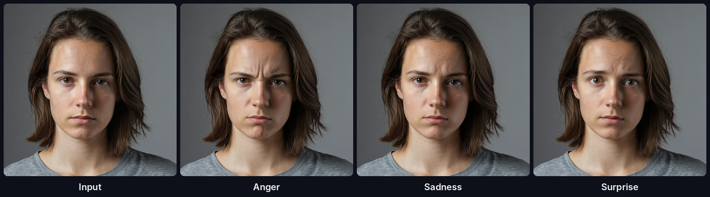

<h1 align="center"> AutoExpress</h1>

<b>One character image in, a full set of 28 facial expressions out.</b>

  
  
  
  

AutoExpress repaints a character's face with 28 different emotions and keeps everything else the same: pose, outfit, background and art style. It's made for expression sprites, such as [SillyTavern](https://github.com/SillyTavern/SillyTavern) character cards and visual novels.

  

## Features

- **Runs where you already generate images.** It works as an extension for AUTOMATIC1111, Forge, reForge and SD.Next, as custom nodes for ComfyUI (and SwarmUI), and as a node for InvokeAI. There's also a standalone app that drives any of those over their API, locally or on a remote GPU.
- **Prompts tuned per model family.** Separate expression prompts for Danbooru-tag anime models, Pony, Illustrious/NoobAI, SDXL and natural-language models such as Flux. **Auto** picks the family from the checkpoint name.
- **Expression LoRAs.** It downloads and applies the right expression LoRA for the checkpoint, reusing a Civitai key you already have set up.
- **Two ways to edit.** Face inpainting uses ADetailer or FaceDetailer. Instruction editing uses Qwen-Image-Edit on ComfyUI, which also works on photos.
- **One intensity slider** sets how far each expression is pushed.
- **Ready for sprites.** Files are named after their expression, and each run can save a labelled sprite sheet.

## Examples

Each sheet shows one input image and eight of its expressions, at 1024×1024. Click a sheet to see it full size.

<table>
  <tr>
    <th>NoobAI-XL (Illustrious)</th>
    <th>Pony V6 XL</th>
    <th>Animagine XL 4 (Danbooru)</th>
  </tr>
  <tr>
    <td width="33%"></td>
    <td width="33%"></td>
    <td width="33%"></td>
  </tr>
</table>

Photos work too. This set was made from a generated portrait with the [instruction edit mode](docs/comfyui.md#instruction-edit-mode-qwen-image-edit) (Qwen-Image-Edit-2511) at the default [intensity](docs/prompt-styles.md#expression-intensity). Only the edited face is pasted back onto the original photo.

  

## Installation

Pick the setup you already use. They all share the same expression prompts and generation logic. Inside a WebUI, AutoExpress runs in-process, so the WebUI doesn't need `--api`.

| You use | Install | Guide |
| --- | --- | --- |
| AUTOMATIC1111, Forge, reForge, SD.Next | **Extensions → Available**, search for **AutoExpress**. Needs [ADetailer](https://github.com/Bing-su/adetailer). | [docs/a1111.md](docs/a1111.md) |
| ComfyUI (and SwarmUI) | ComfyUI Manager, or `comfy node install autoexpress`. Needs [Impact Pack](https://github.com/ltdrdata/ComfyUI-Impact-Pack) and Subpack. | [docs/comfyui.md](docs/comfyui.md) |
| InvokeAI | **Nodes → Git Repository URL** with this repo's URL | [docs/invokeai.md](docs/invokeai.md) |
| Standalone app (drives any of the above) | [Release zip](https://github.com/deepratna-awale/AutoExpress/releases) or `docker run -p 5000:5000 ghcr.io/deepratna-awale/autoexpress` | [docs/standalone.md](docs/standalone.md) |

Fooocus has no extension system, so it isn't supported.

## Quick start

1. Install AutoExpress for your WebUI (see above), then open the **AutoExpress** tab, a ready-made ComfyUI workflow from [`example_workflows/`](example_workflows/), or the standalone app at http://127.0.0.1:5000.
2. Drop in a character image. The prompt, checkpoint, sampler and seed are read from its metadata when it has any.
3. Leave **Prompt Style** on **Auto**, pick the expressions you want, and press **Generate**.
4. The results are saved as `joy.png`, `anger.png` and so on, ready to [use as SillyTavern sprites](docs/sillytavern.md).

<table>
  <tr>
    <td width="50%"> AutoExpress tab in AUTOMATIC1111</td>
    <td width="50%"> AutoExpress nodes in ComfyUI</td>
  </tr>
  <tr>
    <td colspan="2"> Standalone web interface</td>
  </tr>
</table>

## Expressions

| | | | |
| --- | --- | --- | --- |
| Admiration | Amusement | Anger | Annoyance |
| Approval | Caring | Confusion | Curiosity |
| Desire | Disappointment | Disapproval | Disgust |
| Embarrassment | Excitement | Fear | Gratitude |
| Grief | Joy | Love | Nervousness |
| Neutral | Optimism | Pride | Realization |
| Relief | Remorse | Sadness | Surprise |

You can generate all of them, or only the ones you pick.

## Documentation

The full documentation is in [docs/](docs/README.md):

- Setup guides: [A1111 / Forge / SD.Next](docs/a1111.md), [ComfyUI](docs/comfyui.md), [InvokeAI](docs/invokeai.md), [Standalone app](docs/standalone.md)
- [Prompt styles and expression intensity](docs/prompt-styles.md)
- [Expression LoRAs and your Civitai key](docs/expression-loras.md)
- [Instruction edit mode (Qwen-Image-Edit)](docs/comfyui.md#instruction-edit-mode-qwen-image-edit)
- [Using the results with SillyTavern](docs/sillytavern.md)

## Roadmap

- Change the pose along with the expression while keeping clothes and background consistent.
- Better expressions on realistic images.

## Contributing

Contributions are welcome. See [CONTRIBUTING.md](CONTRIBUTING.md) to set up a dev environment and run the tests, and read the [Code of Conduct](CODE_OF_CONDUCT.md). Report security issues as described in [SECURITY.md](SECURITY.md). Changes are listed in the [changelog](CHANGELOG.md).

## Acknowledgements

- [SD Parsers](https://github.com/d3x-at/sd-parsers) by d3x-at
- [SD API Examples](https://github.com/AUTOMATIC1111/stable-diffusion-webui/discussions/3734)
- [Avery Velfaire](https://github.com/AveryVeilfaire), for bug fixes, UI design and prompt engineering
- The authors of the [Facial Expressions](https://civitai.com/models/541620), [Face Enhancer Illustrious](https://civitai.com/models/1625070) and [Expression Helper](https://civitai.com/models/914282) LoRAs

## License

[MIT](LICENSE)
