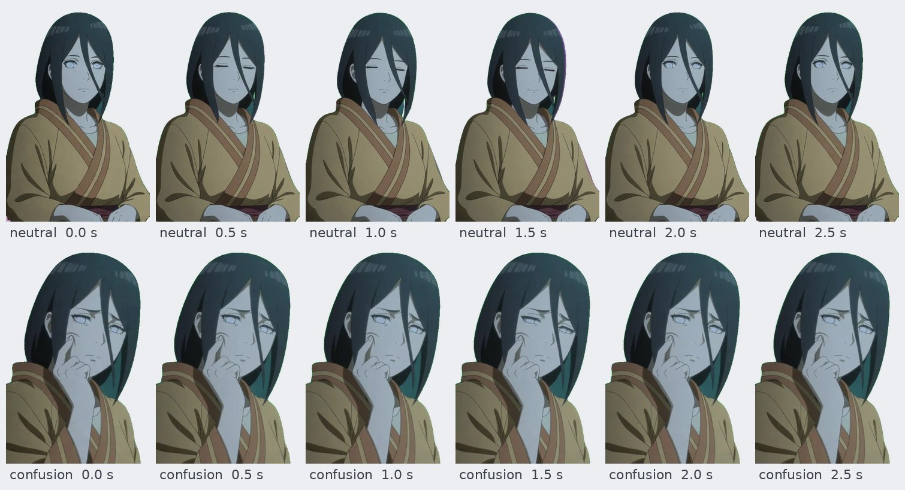

# Animated sprites

AutoExpress can turn every expression into a short looping animation, so a character card becomes a full set of 28 animated sprites, with an idle animation that fits the character.

<table>
  <tr>
    <td width="20%" align="center"><br><sub>neutral (idle)</sub></td>
    <td width="20%" align="center"><br><sub>pride</sub></td>
    <td width="20%" align="center"><br><sub>curiosity</sub></td>
    <td width="20%" align="center"><br><sub>confusion</sub></td>
    <td width="20%" align="center"><br><sub>anger</sub></td>
  </tr>
</table>

These are the animated WebP files exactly as AutoExpress saves them (shrunk for this page), with a transparent background. Each one plays forever. The still under each clip is both its first and its last frame, so the loop has no seam, and the motion is kept small so it can keep playing beside a chat for hours without looking busy.

<p align="center"></p>
<p align="center"><sub>Six frames from two loops, half a second apart. The first and last frames match, so playback wraps around smoothly.</sub></p>


1. Each expression's still is made as usual (face inpainting or Qwen-Image-Edit, with [poses](comfyui.md#instruction-edit-mode-qwen-image-edit) if you turn them on).
2. The still is animated with **Wan 2.2 image to video 14B** on ComfyUI. The still is used as both the first and the last frame, so the clip loops without a jump, and the camera, framing and outfit stay put.
3. **Neutral becomes the idle animation**: its motion comes from the character, see below.
4. With **Remove background** on, the still is cut out and animated on a flat key color, and every frame is cut out again. The alpha is smoothed over time so the edges don't flicker, and the key color is taken back out of the edges. The animations stay transparent.

The animations are made for a chatbot's expression display: they show the character reacting to the last chat message, not talking. The character never speaks, mouths words or lip syncs: with animation on, the Qwen-Image-Edit stills are made with the mouth closed (a surprised or laughing still with an open mouth would open and close it during the clip, which reads as talking), and the motion prompt keeps the lips still, and every motion is small, calm and in place so it can loop beside the chat for a long time. Strong emotions are kept restrained: anger is a frown and a small huff, fear a slight flinch and an uneasy glance. The motions are in [`animations.json`](../autoexpress_core/resources/animations.json).

Clips are 49 frames at 16 fps (3 seconds, 48 frames once the repeated loop frame is dropped), 480p on the short side, and are scaled back to the still's size. They're saved next to the PNGs as `<expression>.webp` (animated WebP, transparent, small; shown by SillyTavern and every browser), and optionally `.apng` and `.gif` (GIF only has on/off transparency).

Wan 2.2 and Qwen-Image-Edit are open-weight models that run on your own ComfyUI with no content filter, so adult characters are animated as they are.

## Needs

A ComfyUI backend (local or on a rented GPU) with the Wan 2.2 files:

```bash
python -m autoexpress_core.animation download /path/to/ComfyUI
```

That's about 38 GB: the high and low noise image to video models (fp8), the UMT5 text encoder, the Wan VAE and the optional 4-step LoRAs. A GPU with 24 GB of VRAM works; 48 GB or more is comfortable. [docs/runpod.md](runpod.md) has the pod, image and a setup script that installs everything.

Clips are sampled in full by default (20 steps): on an RTX PRO 6000 that's about 90 seconds a clip. **Fast** (`"lightning": true`) uses the 4-step LoRAs and takes about 15 seconds, but at their cfg of 1 the negative prompt (talking, lip sync, ...) has no effect, so smiling and upset faces open and close the mouth more, as if talking.

The setup checklist in the app lists the Wan nodes and files with the command to fix what's missing.

## Character cards and the idle animation

Drop a character card (a SillyTavern / Tavern PNG, V1, V2 or V3) as the input image. AutoExpress reads the card from the PNG, fills in the output folder with the character's name and writes the idle motion from the card's description and personality: always breathing, blinking and a little hair and cloth sway, plus a gesture that matches the character's strongest trait (a playful sway and a wink, fidgeting and shy glances, a calm composed stance, a confident chin-up stance, ...).

You can edit the idle motion before generating, or let something else write it:

| Source | What it uses |
| --- | --- |
| **From the card** | The card's description, personality, scenario and tags. |
| **Card + wiki** | The card plus the character's page on the Fandom wiki of the card's tags (e.g. `naruto.fandom.com`), or Wikipedia, for known characters with a thin card. |
| **Ask the LLM** | Any OpenAI compatible chat endpoint (OpenAI, OpenRouter, a local Ollama or LM Studio) writes the idle from the card and the wiki text, using what it knows about the character. Set `AUTOEXPRESS_LLM_URL` (e.g. `http://127.0.0.1:11434/v1`), `AUTOEXPRESS_LLM_MODEL` and, if needed, `AUTOEXPRESS_LLM_API_KEY`, or `POST /llm-settings`. Falls back to the card when the call fails. |

Any picture works too; without a card, the idle is a calm breathing and blinking loop unless you type one.

## In the apps

- **Standalone app**: turn on **Animate sprites** under the output folder. The gallery shows the animations. See the [HTTP API](standalone.md#http-api) for `"animate": true`.
- **SillyTavern extension**: tick **Animate** in the Generate dialog. The idle comes from the character's card (the avatar PNG), and each animated WebP goes into Character Expressions.

## Always playing

Every file is saved to loop forever (WebP, APNG and GIF all carry an endless loop count), so whatever shows the sprite keeps it moving without any extra setup:

- **SillyTavern**: Character Expressions shows the sprite for the emotion of the latest message. With animated sprites, that sprite keeps playing its loop beside the chat, the idle (`neutral`) when nothing stronger is going on, until the next message switches to another emotion's loop. The extension uploads the `.webp` files themselves (the upload keeps them animated), so nothing needs converting. If you copy sprites by hand, copy the `.webp` files into `data/<user>/characters/<character name>/`. Character Expressions shows one sprite per emotion unless **Allow multiple sprites** is on, so keep only the `.webp` for each emotion (not a `joy.png` next to `joy.webp`).
- **Web pages and web-based front ends** play animated WebP in a plain `` in every current browser, and loop it.
- **Visual novel engines and other tools** that don't read animated WebP can use the `.apng` or `.gif` from the `formats` setting. GIF only has on/off transparency, so its edges are harder.

Because each clip is small, calm and seamless, a sprite can sit on screen for a long time without the loop drawing attention to itself. Loops are 3 seconds by default; set `frames` (up to 121, about 7.5 seconds) for a longer, less repetitive cycle.

## HTTP API

`POST /generate` takes `"animate": true` and an optional `"animation"` object:

| Field | Default | |
| --- | --- | --- |
| `formats` | `["webp"]` | Any of `webp`, `apng`, `gif` |
| `idle_motion` | from the card | The neutral clip's motion, in plain words |
| `idle_source` | `card` | `card`, `web`, `llm` or `none`, when `idle_motion` isn't given |
| `frames` | 49 | 17 to 121 (Wan rounds to 4n+1) |
| `fps` | 16 | Playback speed of the saved file |
| `resolution` | 480 | Short side of the video Wan renders |
| `lightning` | false | `true` uses the 4-step LoRAs (about 6× faster, but the negative prompt stops working, so mouths move more) |
| `steps`, `cfg`, `seed` | 20, 3.5 (4, 1 with `lightning`), random | Sampling |
| `loop` | true | Use the still as the last frame too |
| `extra` | | Added to every clip's prompt |

Each finished expression in `GET /jobs/<id>` then has `"animation": "/image/<folder>/<expression>.webp"` and `"animations"` per format.

`POST /animate` animates the stills already in an output folder (`{"output_dir": "Hanabi", "expressions": [...], "animation": {...}, "image": <card>}`), so you can redo the animations without making new stills.

`POST /character-card` with `{"image": <data URI>, "idle_source": "card" | "web" | "llm"}` returns the parsed card and the idle motion. `GET /animation` says whether the connected WebUI can animate, with the defaults and each expression's motion.

The expression motions are in [`autoexpress_core/resources/animations.json`](../autoexpress_core/resources/animations.json).
